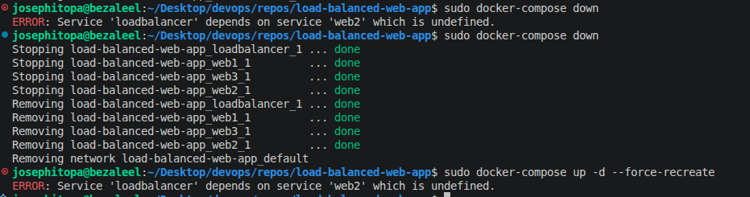
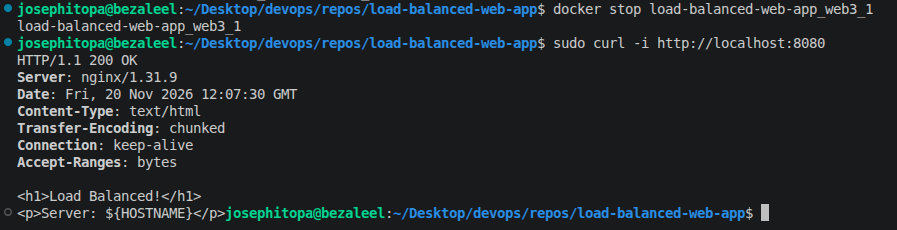

### Deployment of Load Balanced Web App
##### a load-balanced web application with nginx

#### Tech Stack
- Docker, HTML, NGINX

#### How to run
- docker compose up -d

#### EXPERIMENT (break it on purpose): 
#### -------------------
- Remove web2 from docker-compose.yml and run docker compose up -d. Does the balancer care?

#### -------------------
- Stop one container mid-traffic: docker stop <project>-web1-1. Refresh
the browser ten times. What happens?

#### -------------------
- Change the upstream in nginx.conf to a port that doesn't exist. What error do
you get and where does it appear?

